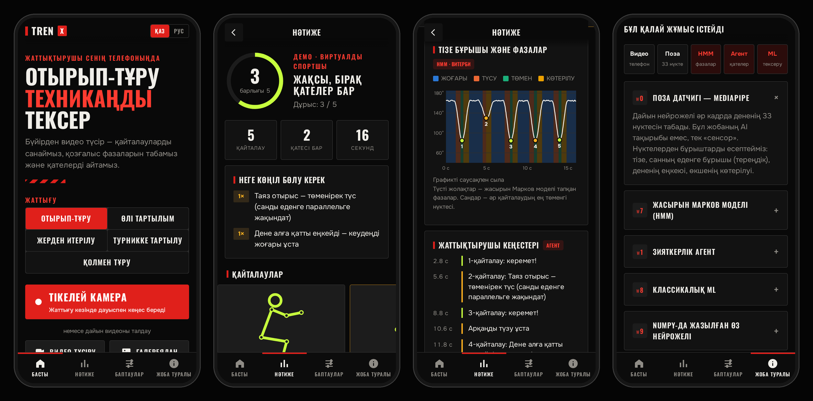
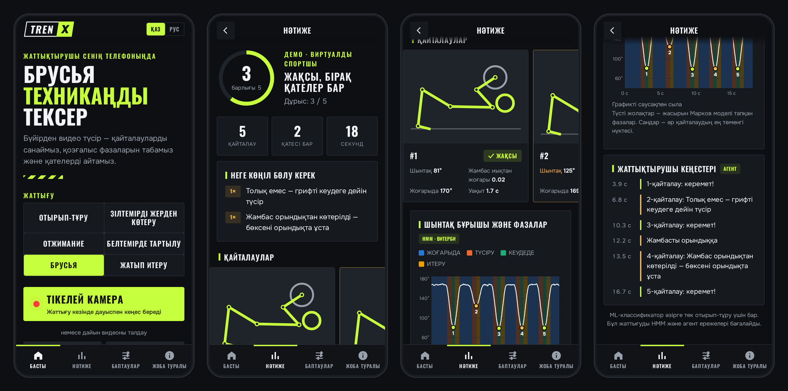

# TREN-X — жаттығу техникасын камера арқылы тексеру

Телефонды бүйірге қоясың да, жаттығуды орындайсың. Жүйе қайталауларды санайды, қозғалыс фазаларын
табады (төмен түсу / ең төменгі нүкте / көтерілу) және әр қайталау бойынша не дұрыс емес екенін
айтады — **тікелей камерада** жаттығу кезінде дауыспен, ал **жүктелген видеода** толық есеппен.

Алты жаттығу:

| Жаттығу | Басты бұрыш (HMM) | Агент табатын қателер |
|---|---|---|
| **Отырып-тұру** (присед) | тізе | таяз отырыс, дененің алға еңкеюі, өкшенің көтерілуі, тым жылдам |
| **Зілтемірді жерден көтеру** (становая тяга) | жамбас (иық–жамбас–тізе) | штанга аяқтан алыс, жоғарыда артқа шалқаю, тізе тым бүгілген (отырып-тұруға айналды), аяқ тым түзу, тым жылдам |
| **Отжимание** | шынтақ | таяз, жамбастың салбырауы, жамбастың жоғары көтерілуі, тым жылдам |
| **Белтемірде тартылу** (подтягивания) | шынтақ | иек турниктен аспады, толық асылмау, тербелу, тым жылдам |
| **Брусья** (отжимания на брусьях) | шынтақ | таяз (шынтақ 90°-қа жетпеді), тым терең (иық шынтақтан әлдеқайда төмен — иыққа зиян), жоғарыда қол түзелмеді, тым жылдам |
| **Жатып итеру** (жим лёжа) | шынтақ | гриф кеудеге жетпеді, жамбас орындықтан көтерілді, жоғарыда қол түзелмеді, тым жылдам |

Брусья мен жатып итеруде «жоғарыда қол түзелмеді» қатесін агент қайталау *алдындағы* шынтақ бұрышынан табады
(жарты қайталаулар). Бұрынғы «қолмен тұру» жаттығуы алынып тасталды: MediaPipe төңкерілген адамды нашар таниды.

**AI Fundamentals** курсының қорытынды жобасы (QAIRU AI Application Development Challenge 2026).

Толық техникалық есеп: [docs/TECHNICAL_REPORT.md](docs/TECHNICAL_REPORT.md) ([.docx](docs/TECHNICAL_REPORT.docx) нұсқасы да бар).
Демо-видео сценарийі: [docs/DEMO_VIDEO_SCRIPT.md](docs/DEMO_VIDEO_SCRIPT.md).

Мобильді сайт екі тілде жұмыс істейді: **қазақша** (әдепкі) және **орысша**, тілді ҚАЗ / РУС батырмасымен ауыстыруға болады.

## Курстың үш (төрт) AI тақырыбы — өз кодымызбен жүзеге асырылған

MediaPipe Pose тек **датчик (сенсор)** ретінде қолданылады: ол кадрды дененің 33 нүктесіне айналдырады.
Техниканы талдаудың бәрі осы жобада жазылған.

| Апта | Тақырып | Код қай жерде | Не істейді |
|---|---|---|---|
| 1 | Зияткерлік агент | `formcoach/agent.py`, `formcoach/exercises.py` | Жаттықтырушы: қабылдау → ішкі күй → «шарт → әрекет» ережелері → кеңестер (әр жаттығудың өз ережелері) |
| 7 | Жасырын Марков моделі (HMM) | `formcoach/hmm.py`, `formcoach/live.py` | Фазалар және қайталауларды санау: өз Витерби алгоритмі (видео), тура алгоритммен сүзгілеу (тікелей камера) |
| 8 | Классикалық машиналық оқыту | `formcoach/classifier.py`, `formcoach/retrain.py` | «Дұрыс / арқа / өкше» классификаторы, 5 модельді салыстыру, әділ тексеру |
| 9 | Нейрондық желілер | `formcoach/mlp.py` | NumPy-да жазылған өз перцептроны: тура өту, қатені кері тарату, градиенттік түсу |

### 1-апта — Жаттықтырушы агент
- **Мақсаты:** тірі жаттықтырушы сияқты, видео барысында техника бойынша кеңес беру.
- **Түрі:** әлем моделі бар рефлекторлық агент (Russell & Norvig).
  **PEAS:** P — дұрыс саналған қайталаулар мен нақты кеңестер; E — камера алдындағы адам;
  A — экрандағы хабарламалар; S — камера + MediaPipe + HMM.
- **Кіріс:** әр кадрда HMM берген фаза және дене бұрыштары (тізе, сан, дененің еңкеюі, өкшенің көтерілуі).
  Агент бүкіл видеоны бірден көрмейді.
- **Қадамдар:** күйде қайталау нөмірін, ең кіші бұрышты, ең үлкен еңкеюді есте сақтау →
  ережелерді тексеру (`еңкею > 30°` → «арқаңды түзу ұста», `сан 35°-қа дейін түспеді` → «төменірек түс» т.б.) →
  ok / warn / danger деңгейіндегі кеңес беру.
- **Шығыс:** кадр нөмірі көрсетілген кеңестер тізімі және әр қайталау бойынша есеп.
- **Интерфейстегі параметрлер:** ережелердің барлық шектері (тереңдік, еңкею, өкше, ұзақтық).
- **Басқа жаттығулар** (`exercises.py`): агент сол, бірақ ережелері жаттығу сипаттамасынан алынады —
  «қайталаудағы белгінің ең үлкен/ең кіші мәні шектен асты → қате» түріндегі тізім. Мысалы, турникте
  `ауыз білезіктен төмен қалды` → «иекті турниктен асыр», отжиманиеде `жамбас иық–тобық сызығынан 15°-тан
  көп төмен` → «белді майыстырма». Зілтемірді жерден көтеруде артқа шалқаю адам тік тұрғаннан кейін болады,
  сондықтан агент қайталау аяқталғаннан кейін тағы ~1 секунд бақылайды.
- **Шектеулер:** шектер қолмен қойылған. Табан нашар көрінсе, өкше бағаланбайды.
  Зілтемірді жерден көтерудің екі шегі (тізе 90°, штанга 0.7) ашық MyDeadlift датасетінде іріктелді; өкшенің 0.2 шегі мен
  отжимание, турник, брусья, жатып итеру шектері әзірге нақты видеоларда іріктелмеген.

### 7-апта — HMM: фазалар мен қайталаулар
- **Мақсаты:** видеоны фазаларға сенімді бөлу және шуға алданбай қайталауларды санау.
- **Жасырын күйлер:** ЖОҒАРЫ → ТҮСУ → ТӨМЕН → КӨТЕРІЛУ → ЖОҒАРЫ. **Бақылаулар:** тізе бұрышы және оның жылдамдығы.
- **Қадамдар:** бақылаулардың Гаусс ықтималдықтары → **Витерби** (динамикалық бағдарламалау) фазалардың
  ең ықтимал тізбегін табады → **тура алгоритм** log P(видео | модель) мәнін береді: видео жалпы
  отырып-тұруға қаншалықты ұқсайды. Ықтималдықтар нөлге айналмауы үшін бәрі логарифмде есептеледі.
- **Неге жай «бұрыш < 100°» шегі емес:** шек шуға байланысты секіреді және түсу мен көтерілуді
  ажыратпайды, өйткені екеуінде бұрыш бірдей. HMM жылдамдықты және фазалардың қатаң ретін ескереді.
- **Тікелей камерада** болашақ кадрлар жоқ, сондықтан Витербидің орнына **сүзгілеу** (тура алгоритмнің
  бір қадамы): P(қазіргі фаза | осыған дейінгі кадрлар). Фаза тек рұқсат етілген ауысулар бойынша өзгереді,
  ал «қалу ықтималдығы» телефонның нақты кадр жиілігіне қарай қайта есептеледі (`stay^(30·dt)`).
  Тест: 30 / 15 / 10 / 5 кадр/с жылдамдықта тікелей режим видео талдауымен бірдей қайталау мен қателер береді.
- **Алты жаттығуға бір модель:** өзгеретіні — басты бұрыш (тізе, жамбас, шынтақ) және
  «тұрғандағы» / «төмендегі» мәндері. Турникте «ЖОҒАРЫ» фазасы — асылып тұру (шынтақ түзу), сондықтан фаза атаулары өзгеше.
- **Интерфейстегі параметрлер:** тұрғандағы және төмендегі бұрыш, фазада қалу ықтималдығы.
- **Шектеулер:** параметрлер қолмен берілген (Баум — Велш оқытуынсыз). Модельдер бүйірден көрініске арналған.

### 8-апта — Техника классификаторы
- **Мақсаты:** агент ережелеріне қосымша, қайталаудың екінші тәуелсіз бағасы.
- **Кіріс:** ең төменгі нүктедегі позаның 7 белгісі: тізе, жамбас, санның еденге, сирақтың, тобықтың
  бұрыштары, дененің еңкеюі, өкшенің көтерілуі. Бұлар бұрыштар мен ұзындықтар қатынасы, сондықтан
  камераға дейінгі қашықтыққа тәуелді емес.
- **Деректер:** Binus University ашық датасеті ([Zenodo 17558630](https://zenodo.org/records/17558630)),
  бүйірден түсірілген 3741 фото, 3 класс.
- **Басты тұзақ:** датасеттегі көрші фотолар — бір видеоның бір-біріне өте ұқсас кадрлары. Оларды
  кездейсоқ бөлсе, дәлдік асыра көрсетіледі. Сондықтан фотолар клиптерге топталады және тексеру тек
  модель көрмеген клиптерде жүреді (**GroupKFold**). Бөлек test жиыны — басқа адамдар.
- **Шығыс:** әр қайталау үшін «дұрыс / арқа / өкше» кластарының ықтималдықтары
  (ең төменгі нүкте ±3 кадр бойынша орташаланады).
- **Табан көрінбесе:** дененің тек жоғарғы бөлігі бойынша қосалқы модель (дұрыс / арқа).
- **Өз видеоларымызда қосымша оқыту** (`retrain.py`): өзіміз белгілеген қайталаулар Binus-қа қосылады.
  Бағалау — **leave-one-video-out**: әр өз видеомызды сол видеоны көрмеген модель тексереді.
- **Шектеулер:** Binus-тағы қателер әсірелеп көрсетілген (еңкею ~64°). Тек Binus-та оқыған модель
  нақты адамның жеңіл қателерін байқамайды. Өз белгілеуіміз осы үшін керек.

### 9-апта — Өз нейрожеліміз (NumPy-дағы MLP)
- **Архитектура:** 7 кіріс → 16 ReLU нейрон → softmax (3 класс).
- **Қадамдар:** тура өту → айқас энтропия + L2 → **қатені кері тарату** (формулалары `mlp.py`
  басында) → мини-батчтар және моменті бар градиенттік түсу.
- **Тексеру:** backprop градиенттері сандық градиенттермен салыстырылады. Желі жасырын қабатсыз
  шешілмейтін XOR есебін шешеді.
- CV бойынша желі бес модельдің ең жақсысы болды, сондықтан қосымша дәл соны қолданады.
- **Шектеулер:** бір ғана жасырын қабат, гиперпараметрлер қолмен таңдалған. Test жиынында ол
  логистикалық регрессиядан жақсы емес: белгілер аз, есеп сызықтыққа жақын.

## Метрикалар

Дұрыс жауабы белгілі 300 синтетикалық сессиядағы HMM мен агент (`python scripts/eval_synthetic.py`):

| Не өлшейміз | Нәтиже |
|---|---|
| Қайталау саны дәл саналды: HMM + агент | **100 %** |
| Дәл сол, қарапайым «тізе бұрышы < 120°» шегі үшін | 46.3 % |
| Агенттің қате табуы, F1 (таяз / еңкею / өкше / жылдам) | 1.00 / 1.00 / 1.00 / 0.99 |

Басқа жаттығулар, әрқайсысына 200 синтетикалық сессия (`python scripts/eval_exercises.py`):

| Жаттығу | Қайталау саны дәл: HMM + агент | Қарапайым шек (бұрыш ортадан төмен) | Қателер, F1 |
|---|---|---|---|
| Зілтемірді жерден көтеру | **100 %** | 100 % | штанга алыс 1.00 · артқа шалқаю 1.00 · отырып-тұру 1.00 · түзу аяқ 1.00 · жылдам 1.00 |
| Отжимание | **100 %** | 73.0 % | таяз 0.98 · салбырау 1.00 · жамбас жоғары 1.00 · жылдам 1.00 |
| Белтемірде тартылу | **100 %** | 100 % | иек 0.95 · толық асылмау 1.00 · тербелу 1.00 · жылдам 1.00 |
| Брусья | **100 %** | 81.0 % | таяз 0.99 · тым терең 1.00 · түзелмеді 0.94 · жылдам 0.95 |
| Жатып итеру | **98.5 %** | 69.0 % | кеудеге жетпеді 1.00 · жамбас көтерілді 1.00 · түзелмеді 0.95 · жылдам 0.96 |

Зілтемір көтеру мен турникте қозғалыс амплитудасы үлкен, сондықтан қарапайым шек те дұрыс санайды. Отжиманиеде таяз
қайталаулар ортаңғы бұрышқа жетпейді, шек оларды өткізіп алады, ал HMM жылдамдықты ескеріп санайды.
F1 < 1 болатын жерлер: тым жылдам қайталауда тегістеу шыңды «кеседі», сондықтан кейде «таяз» / «иек»
қатесі де қосылады.

Синтетика идеалдандырылған: ол тек логиканы тексереді. Нақты видеолардағы сандар — төменде.

### Нақты видеолардағы тексеру (ашық датасеттер)

Екі ашық датасеттің бөтен адамдар түсірген 511 видеосы (`python scripts/fetch_real_datasets.py`, сосын
`python scripts/eval_real.py`): **RepCount-A** — қайталау саны белгілі YouTube видеолары (кез келген ракурс,
монтаж), **MyDeadlift** — бүйірден түсірілген зілтемірді жерден көтеру, әр видеода бір қайталау.

| Жаттығу (RepCount-A) | Видео | HMM + агент: дәл / ±1 / орташа қате | Қарапайым шек: дәл / ±1 / орташа қате |
|---|---|---|---|
| Отырып-тұру | 31 | **29 %** / 58 % / **2.8** | 16 % / 58 % / 4.3 |
| Отжимание | 34 | **41 %** / 59 % / **4.0** | 21 % / 53 % / 4.2 |
| Белтемірде тартылу | 33 | **45 %** / 64 % / **2.5** | 24 % / 64 % / 2.7 |
| Белтемірде тартылу, жаңа видеолар | 90 | **34 %** / 52 % / 3.9 | 22 % / 54 % / **2.6** |
| Жатып итеру | 93 | 10 % / 20 % / 6.6 | **15 %** / **35 %** / **6.4** |

**Жатып итеру** (RepCount-A-ның барлық 125 видеосы, параметрлер оларда іріктелмеген) нақты видеода әлсіз: дәл санау
тек 10 %, орташа қате 6.6 қайталау, қарапайым шек сәл жақсы. 32 видеода адам кадрлардың жартысынан азында табылды:
YouTube-та жатып итеруді көбіне алдынан немесе жоғарыдан түсіреді, қолды гриф пен дискілер жабады, ал жатқан адамды
MediaPipe нашар таниды. HMM параметрлерін оқыту бөлігінде (93 видео) іріктеп көрдік — орташа қате тек 6.6 → 6.1,
сондықтан параметрлер өзгертілмеді: себеп позаны танудың сапасында. Жатып итеру үшін камера бүйірден, орындық
деңгейінде тұруы керек.

| MyDeadlift белгісі | Видео | Қайталау саны дәл (1 болуы керек) | Ескертусіз | Агенттің жиі ескертулері |
|---|---|---|---|---|
| Дұрыс | 83 | 92 % | 69 % | отырып-тұру 20 % · штанга алыс 10 % |
| Дөңес арқа | 54 | 94 % | 83 % | отырып-тұру 7 % |
| Тізе алға шығады | 54 | 100 % | 22 % | отырып-тұру 78 % |

«Дәл» — саналған сан шын санмен тең видеолар үлесі, «±1» — айырма бірден аспайды, «орташа қате» — қайталаумен.

Осы тексеруден кейін үш нәрсе түзетілді: зілтемірді жерден көтеру енді еденнен басталса да саналады (бұрын видеолардың
2 %-ында ғана саналатын), зілтемір көтеру шектері MyDeadlift-тің оқыту бөлігінде іріктелді («тізе алға шығады»
қатесі тест бөлігінде F1 0.72), турникте кадр тек білезік иықтан жоғары болса есептеледі (жаңа 90 видеода
дәл санау 23 % → 34 %, орташа қате өзгермеді).

Әділ қорытынды: еркін YouTube видеоларында дәл санау әлсіз (шамамен үштен бірі), HMM қарапайым шектен дәл
санауда жақсы, бірақ жаңа турник видеоларында шектің орташа қатесі аз. Жүйе бүйірден түсірілген видеоға
есептелген. Дұрыс зілтемір көтерулердің 31 %-ына агент әлі де жалған ескерту береді.

Классификатор (macro-F1, `python -m formcoach.classifier`):

| Модель | Accuracy, жаңа клиптер (CV) | F1, жаңа клиптер (CV) | Accuracy, test | F1, test |
|---|---|---|---|---|
| Агенттің қолмен жазылған ережелері | 0.463 | 0.399 | 0.418 | 0.317 |
| Логистикалық регрессия | 0.988 | 0.988 | 0.863 | 0.862 |
| Шешім ағашы (тереңдігі 4) | 0.959 | 0.960 | 0.852 | 0.850 |
| Кездейсоқ орман | 0.967 | 0.968 | 0.869 | 0.868 |
| k жақын көрші (k=15) | 0.986 | 0.987 | 0.873 | 0.871 |
| **Өз MLP нейрожеліміз (NumPy)** | **0.989** | **0.989** | 0.861 | 0.859 |
| Табансыз (дұрыс / арқа) | 0.955 | 0.955 | 0.898 | 0.897 |

CV (0.99) мен test (0.86) арасындағы айырма модельдің жаңа адамдарға қаншалықты ауысатынын көрсетеді.
Әділ сан — test.

Өз видеоларымызда қосымша оқыту (`python -m formcoach.retrain`): әзірге бір ғана видео белгіленген,
сондықтан «дейін» мен «кейін» бірдей. Нәтижелер 4 видео белгіленгеннен кейін шығады.

Жылдамдық: HMM + агент талдауы секундтың бір бөлігін алады. Ең ұзақ жұмыс — CPU-дағы MediaPipe
позаны тануы, шамамен видеоның нақты уақытындай. Барлық модельдерді оқыту ~18 с алды.

## Архитектура

```
 тікелей камера: телефонда MediaPipe JS ──► WebSocket арқылы тек 33 нүкте ──┐
 жүктелген видео ──► pose.py (MediaPipe, серверде) ──► кадрға 33 нүкте ───────┤
                                                                            ▼
                        features.py (отырып-тұру) / exercises.py (зілтемір көтеру, отжимание, турник)
                                      бұрыштар, жылдамдықтар
                                              │
                    ┌─────────────────────────┼──────────────────────────┐
                    ▼                         ▼                          ▼
             hmm.py (7-апта)          agent.py / exercises.py     classifier.py / mlp.py
   видео: Витерби, камера: сүзгілеу ─► (1-апта) ережелер → кеңестер   (8–9-апта, тек отырып-тұру)
                    └──────── pipeline.py (видео) · live.py (камера) ────┘
                                              │
                    ┌─────────────────────────┴──────────────────────────┐
                    ▼                                                    ▼
      server.py (FastAPI: JSON API + WebSocket)                   app.py (Streamlit)
      web/ — телефонға арналған мобильді сайт (PWA)    «Анализ» · «Разметка» ──► labels.py ──► retrain.py
```

| Файл | Міндеті |
|---|---|
| `server.py` | Мобильді сайттың сервері: видеоны қабылдайды (`/api/analyze`), тікелей камераның нүктелерін WebSocket арқылы алады (`/ws/live`), JSON қайтарады; мәтіндерді қазақша және орысша береді |
| `web/` | Мобильді интерфейс (HTML/CSS/JS): жаттығуды таңдау, тікелей камера (`live.js`: MediaPipe JS, қаңқа, дауыстық кеңестер), видео түсіру, нәтиже, баптаулар; PWA. Мәтіндер `web/i18n.js`, дауыс фразалары `web/audio/` ішінде |
| `app.py` | Әзірлеушіге арналған Streamlit интерфейсі: толық кестелер және өз видеоларын белгілеу |
| `formcoach/pose.py` | Видео → дене нүктелері (MediaPipe Pose Landmarker) |
| `formcoach/features.py` | Буын бұрыштары, тегістеу, кадр белгілері |
| `formcoach/hmm.py` | Гаусс HMM, Витерби, тура алгоритм |
| `formcoach/agent.py` | Отырып-тұрудың жаттықтырушы агенті және оның ережелері |
| `formcoach/exercises.py` | Зілтемірді жерден көтеру, отжимание, турник, брусья, жатып итеру: жаттығу сипаттамасы (басты бұрыш, ережелер, мәтіндер), ортақ агент, видео және камера талдауы, демо |
| `formcoach/live.py` | Тікелей камера: кадр бойынша талдау, HMM сүзгілеу |
| `formcoach/classifier.py` | Модельдерді оқыту және салыстыру, қайталауды жіктеу |
| `formcoach/mlp.py` | NumPy-дағы өз нейрожеліміз |
| `formcoach/labels.py` | Қайталауларды өзіміз белгілеуді сақтау |
| `formcoach/retrain.py` | Өз видеоларымызда қосымша оқыту, «дейін / кейін» бағасы |
| `formcoach/synthetic.py` | Тесттер мен демо режиміне арналған синтетикалық отырып-тұру |
| `scripts/build_binus_features.py` | Binus датасеті → белгілер кестесі |
| `scripts/eval_synthetic.py` | Синтетикадағы HMM мен агент метрикалары (отырып-тұру) |
| `scripts/eval_exercises.py` | Дәл сол, қалған төрт жаттығу үшін |

## Орнату және іске қосу

**Python 3.12** керек: MediaPipe Python 3.14-ті қолдамайды. Ең ыңғайлысы — [uv](https://docs.astral.sh/uv/) арқылы:

```bash
git clone https://github.com/reysalomon/tren-x.git
cd tren-x
uv venv --python 3.12 .venv
uv pip install --python .venv -r requirements.txt
```

Fedora-да (соның ішінде WSL-де) MediaPipe-ке жүйелік графикалық кітапханалар керек:

```bash
sudo dnf install libglvnd-egl libglvnd-gles mesa-libEGL
```

(Ubuntu/Debian-да: `sudo apt install libegl1 libgles2`)

Мобильді сайтты іске қосу:

```bash
.venv/bin/uvicorn server:app --host 0.0.0.0 --port 8000
```

http://localhost:8000 ашылады. Сайтты сол Wi-Fi желісіндегі телефоннан ашу үшін
`http://<компьютердің IP-і>:8000` мекенжайына кір. Видео түсіру мен таңдау осылай да жұмыс істейді,
ал «қосымша ретінде» орнату HTTPS талап етеді, яғни сайтты интернетке шығару керек (төменде қара).

Телефонда: браузер мәзірі → **«Басты экранға қосу»** (Android-та сайттағы «Орнату» батырмасы).
TREN-X белгішесі пайда болады және сайт қосымша сияқты толық экранда ашылады.

Әзірлеуші интерфейсі және өз видеоларын белгілеу (Streamlit, орыс тілінде):

```bash
.venv/bin/streamlit run app.py
```

http://localhost:8501 ашылады. Кітапханаларды орнатқаннан кейін ImportError шықса,
streamlit-ті толық қайта іске қос (Ctrl+C, сосын қайта жүргіз).

### Интернетке шығару

Жылдам демо үшін — Cloudflare уақытша туннелі (тіркелусіз, тегін). Сервер жұмыс істеп тұрғанда
бөлек терминалда:

```bash
cloudflared tunnel --protocol http2 --url http://localhost:8000
```

Ол `https://….trycloudflare.com` сілтемесін береді, оны телефонда ашуға болады (әр іске қосқанда сілтеме жаңа).
**Тікелей камера тек HTTPS арқылы жұмыс істейді** — браузер `http://` бетке камераны бермейді, сондықтан
телефонда тікелей режим үшін туннель керек. `--protocol http2` — әдепкі QUIC байланысы бірнеше минуттан
кейін үзіліп, WebSocket жоғалғандықтан.

Тұрақты орналастыру үшін репозиторийде `Dockerfile` бар (порт 7860): оны Docker қолдайтын кез келген хостингте іске қосуға болады.

Поза моделі (`models/pose_landmarker_full.task`), оқытылған классификатор және Binus белгілер
кестесі репозиторийде бар, сондықтан ештеңе жүктеудің қажеті жоқ.

### Қалай пайдалану керек

**Мобильді сайт:**
1. Басты бетте жаттығуды таңда: отырып-тұру, зілтемірді жерден көтеру, отжимание, белтемірде тартылу, брусья немесе жатып итеру.
2. **«Тікелей камера»** — телефонды 2–3 метрге бүйірден қой. Экранда қаңқа, қайталау саны және фаза
   көрінеді, қате болса жаттықтырушы дауыспен айтады. «Аяқтау» батырмасы толық есепті ашады.
   Видео телефоннан шықпайды — серверге тек дене нүктелері барады.
3. Немесе **«Видео түсіру» / «Галереядан»** — дайын видеоны талдау. Видео жоқ болса — «Демоны іске қосу»
   (виртуалды спортшы таңдалған қателерді жасайды).
4. «Нәтиже» бетінде: дұрыс қайталаулар саны, әр қайталаудың карточкасы, HMM фазалары бар басты бұрыштың
   графигі, жаттықтырушы кеңестері. «Баптаулар» бетінде таңдалған жаттығудың агент шектері, HMM параметрлері
   және тіл ауыстырғыш.

**Streamlit интерфейсі:**
1. Бүйірлік панельде «Загрузить видео» немесе видео жоқ болса «Демо (синтетические данные)» таңда.
2. Видео: камера **бүйірден**, бүкіл дене кадрда, мүмкіндігінше табанмен бірге.
3. **«Анализ»** қойындысында фазалар графигін, қателері мен модель пікірі бар қайталаулар кестесін,
   жаттықтырушы кеңестерін және алгоритмдер түсіндірмесін қара.
4. Агент шектері мен HMM параметрлері бүйірлік панельдегі жүгірткілермен өзгереді, нәтиже бірден қайта есептеледі.
5. **«Разметка»** қойындысында әр қайталауда шын мәнінде не болғанын белгіле де, «Сохранить» бас.
   Бұл — қосымша оқытуға арналған деректер.

### Модельдерді қайта оқыту

```bash
.venv/bin/python -m formcoach.classifier        # Binus-та модельдерді оқыту және салыстыру
.venv/bin/python -m formcoach.retrain           # өз видеоларымыздағы «дейін / кейін» есебі
.venv/bin/python -m formcoach.retrain --save    # қосымша оқытылған модельді қосымша үшін сақтау
```

Binus фотоларынан белгілерді қайта жинау тек белгілер өзгерсе ғана керек. Ол үшін датасетті
Zenodo-дан жүктеп, `data/external/binus/{train,test}/…` ішіне аш та,
`.venv/bin/python scripts/build_binus_features.py` іске қос.

## Тесттер

```bash
.venv/bin/python -m pytest -q
```

Нәтиже: **133 passed** (~15–20 с). Не тексеріледі:

- `test_core.py` — бұрыштар геометриясы, тегістеу, HMM: қайталауларды санау, фазалар реті, таяз отырыс,
  орнында тұру = 0 қайталау, Витерби ≤ толық ықтималдық, қате параметрлер қабылданбайды.
- `test_agent.py` — әр қате табылады, кеңес қайталау аяқталмай тұрып келеді, шектер өзгереді,
  шу / жүру / аяқталмаған қайталау саналмайды, табан көрінбесе өкше бағаланбайды.
- `test_classifier.py` — клиптерге бөлу, ережелер, кадр белгілері, табансыз қосалқы модель,
  белгілердегі бос мәндер қабылданбайды.
- `test_mlp.py` — backprop пен сандық градиентті салыстыру, XOR, ықтималдықтар, қайталанымдылық, кіріс қателері.
- `test_retrain.py` — өз белгілерімізді кластарға аудару, кадрлар терезесі, қосымша оқыту жаңа видеодағы
  жеңіл еңкеюді байқайды.
- `test_labels.py` — белгілеуді сақтау және қайта жазу, қате белгілеу сақталмайды.
- `test_app.py` — қосымша іске қосылады, демо режим қателерді табады, жүгірткі нәтижені өзгертеді.
- `test_live.py` — тікелей камера: сүзгілеу қадамдарының қосындысы тура алгоритммен бірдей, нақты видеоның
  нүктелерін кадр-кадрмен бергенде (30 / 15 / 10 / 5 кадр/с) видео талдауымен бірдей нәтиже, WebSocket хаттамасы,
  фаза «ТҮСУ»-де тұрып қалмайды, әр дауыс фразасы екі тілде бар (mp3 немесе браузердің сөйлеу синтезіне мәтін).
- `test_exercises.py` — зілтемірді жерден көтеру, отжимание, турник, брусья, жатып итеру: геометриялық «қаңқада» бұрыштар мен бағыт, әр қате
  табылады, қайталаулар екі бағытта да саналады, еденнен басталатын зілтемір көтеру саналады, турниктен тыс қол бүгу
  саналмайды, тікелей режим = видео талдауы, демо, сервер API-і және WebSocket.
- `test_server.py` — мобильді сайт API-і: демо, баптаулар нәтижені өзгертеді, қате баптаулар мен файлдар
  түсінікті хабармен қабылданбайды, адамсыз видео, нақты видеодағы дене нүктелерімен толық талдау,
  мәтіндер қазақша және орысша келеді, қате хабарлары таңдалған тілде.

## Скриншоттар

**Телефондағы мобильді сайт** (демо режим): басты бет, нәтиже, HMM фазаларының графигі, алгоритмдер түсіндірмесі


**Жаңа жаттығулар** (демо режим): жаттығуды таңдау және жаңа жаттығулардың нәтижелері


Әзірлеуші интерфейсі (Streamlit), «таяз» және «еңкею» қателері бар демо режим:

**Тізе бұрышы графигіндегі HMM фазалары және талдау қорытындысы**


**Қайталаулар және жаттықтырушы агенттің кеңестері**


**Алгоритмдер түсіндірмесі және модельдерді салыстыру**


## Жобаның шектеулері
- Тек бүйірден көрініс. Турникте тербелу тек бүйірден көрінеді.
- Арқаның бүгілуін (дөңес арқа) анықтау мүмкін емес: MediaPipe-та омыртқа нүктелері жоқ, тек иық пен жамбас.
- ML-классификатор (8–9-апта) тек отырып-тұру үшін оқытылған. Қалған бес жаттығуды HMM мен агент ережелері бағалайды.
- Еркін түсірілген нақты видеоларда қайталау саны видеолардың шамамен үштен бірінде ғана дәл шығады, жатып итеруде — тек 10 %-ында (жатқан адамды MediaPipe нашар таниды); отжимание мен
  турниктің, брусья мен жатып итерудің қате ережелері нақты видеода тексерілмеген (брусья үшін ашық датасет табылмады).
- Брусья мен жатып итерудің 4 жаңа дауыс фразасы mp3 ретінде жазылмаған — оларды телефонның өз сөйлеу синтезі айтады.
- Сапа MediaPipe-қа тәуелді: жарық нашар болса немесе табан кадрдан шығып кетсе, нүктелер «секіреді».
- Өзіміз белгілеген видеолар әзірге аз. Агент шектерін баптау және қосымша оқыту — келесі қадам.
- Бұл оқу жобасы, медициналық кеңес емес. Ауырсыну болса, жаттығуды тоқтату керек.

## Қатысушылардың үлесі
Жобаны бір студент орындады (GitHub: [reysalomon](https://github.com/reysalomon)): есепті қою және
шешімдер қабылдау, өз видеоларын жинау және белгілеу, нақты деректерде тексеру, қорғау. Код, тесттер
және құжаттама студенттің нұсқауы бойынша Claude Code AI-ассистентінің көмегімен жазылды. Толығырақ —
[AI Usage Declaration](docs/AI_USAGE_DECLARATION.md) және [Team Contribution Statement](docs/TEAM_CONTRIBUTION.md) құжаттарында.
