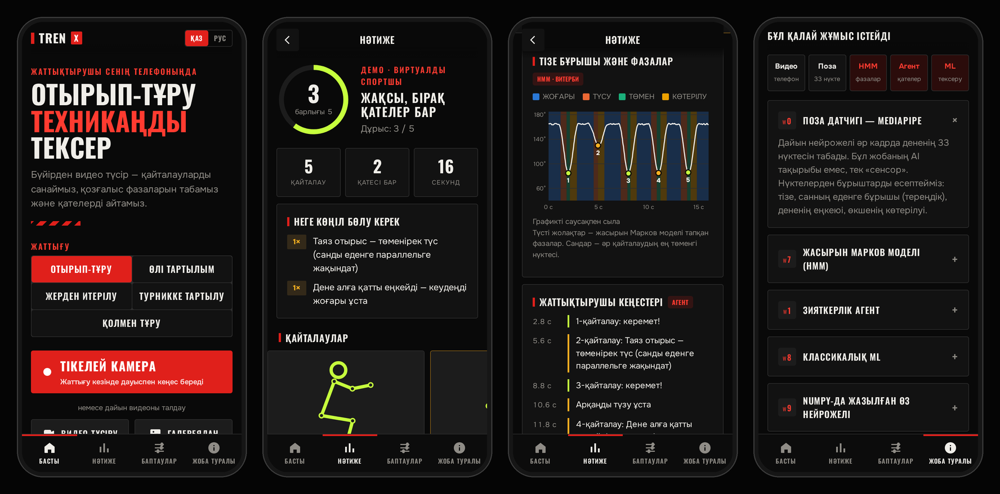
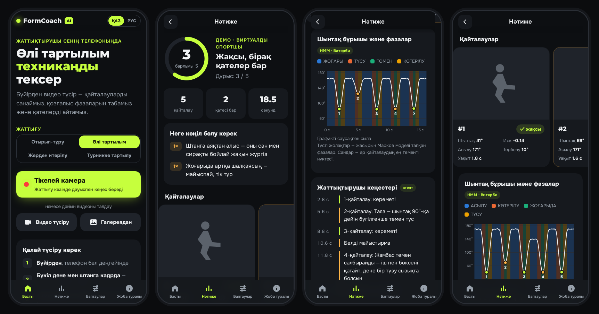

# Аңдатпа

FormCoach AI — телефон браузерінде ашылатын және басты экранға қосымша ретінде орнатылатын мобильді
веб-сайт (PWA). Ол төрт жаттығуды бағалайды: **отырып-тұру, өлі тартылым, жерден итерілу және турникке
тартылу**. Қайталауларды санайды, қозғалыс фазаларын табады және техника қателері туралы хабарлайды
(мысалы, таяз отырыс, штанганың аяқтан алыстауы, жамбастың салбырауы, иектің турниктен аспауы).
Екі режим бар: **тікелей камера** — жаттығу кезінде дауыспен кеңес береді, ал видео телефоннан
шықпайды; және **жүктелген видеоны** толық талдау. Сайт екі тілде жұмыс істейді: қазақша және орысша.
MediaPipe поза детекторы тек буындардың координаттарын беретін датчик ретінде қолданылады. Қозғалысты
талдау курстың төрт тақырыбына негізделген және толығымен өз кодымызбен жүзеге асырылған:

- **жаттықтырушы агент** (1-апта);
- өз Витерби алгоритмі бар **жасырын Марков моделі** (7-апта);
- жаңа адамдарда әділ тексерілген **техника классификаторлары** (8-апта);
- қатені кері таратуы қолмен жазылған **NumPy-дағы көпқабатты перцептрон** (9-апта).

Ашық датасетте (3741 фото, 3 класс) ең жақсы модель жаңа клиптерде **0.989**, ал оқытуда болмаған
адамдарда **0.86** macro-F1 береді. Сол деректерде қолмен жазылған ережелер тек 0.32 береді.
300 синтетикалық сессияда HMM отырып-тұру қайталауларын **100 %** жағдайда дұрыс санайды, ал қарапайым
шек — 46 %. Қалған үш жаттығуда (әрқайсысына 200 сессия) санау да 100 %, агент қателерінің F1 0.95–1.00. Позаны тану нақты уақытта жұмыс істейді (CPU-да ~30 кадр/с), талдаудың өзі бір видеоға
~0.1 с алады.

# 1. Есептің қойылымы

**Мәселе.** Үйде жаттықтырушысыз жаттығатын адамдар отырып-тұруды жиі қатемен орындайды: таяз,
денені еңкейтіп немесе өкшені көтеріп. Бұл жаттығудың пайдасын азайтады және арқа мен тізеге
түсетін жүктемені арттырады.

**Мақсат.** Телефонмен түсірілген қарапайым видео бойынша:

1. қайталауларды санайтын;
2. әр қайталаудың фазаларын анықтайтын;
3. әр қайталау үшін нақты қателерді атап, оларды қалай түзету керегін түсіндіретін;
4. алгоритмнің жауапқа қалай келгенін көрсетіп, оның параметрлерін өзгертуге мүмкіндік беретін;
5. жаттығу кезінде, тірі жаттықтырушы сияқты, камера арқылы бірден кеңес беретін қосымша.

**Курс талабы.** Силлабустың кемінде үш түрлі аптасының әдістері өз кодымызбен жүзеге асырылуы
керек. Дайын AI API-ді қосу есептелмейді. Жобада төрт тақырып бар: 1, 7, 8, 9-апталар.

**Шекаралар.** Төрт жаттығу (отырып-тұру, өлі тартылым, жерден итерілу, турникке тартылу), тек бүйірден
көрініс, кадрда бір адам. ML-классификатор тек отырып-тұру үшін оқытылған (тек оған ашық датасет бар).

# 2. Деректер

| Дереккөз | Бұл не | Көлемі | Не үшін |
|---|---|---|---|
| Binus University, Zenodo 17558630 | Бүйірден түсірілген отырып-тұру фотолары, кластар: good / bad back / bad heel | 3806 фото → сүзгіден кейін 3741, 58 клип, ~6 адам | Классификаторды оқыту және тексеру |
| Өз видеоларымыз (телефон) | Автордың нақты отырып-тұруы, қосымшада белгіленген | 1 видео, 4 қайталау (жинау жалғасуда) | Қосымша оқыту және нақты адамда тексеру |
| Синтетикалық сессиялар (`synthetic.py`) | Жауабы белгілі формуламен генерацияланған белгілер | 300 сессия, 3–8 қайталау, шу 1–5° | HMM мен агенттің тесттері және метрикалары |
| Басқа жаттығулардың синтетикасы (`exercises.py`) | Өлі тартылым, итерілу, турник: кездейсоқ күші бар кездейсоқ қателер | 3 × 200 сессия, 3–8 қайталау, шу 1–4° | Дәл солай |
| Геометриялық «қаңқа» (тесттерде) | Берілген бұрыштар бойынша салынған 33 нүкте | әр жаттығуға бірнеше сессия | Белгілер мен тікелей режимнің тесттері |

**Binus-ты дайындау** (`scripts/build_binus_features.py`). MediaPipe әр фотода дененің 33 нүктесін
табады. Поза табылмаған (36 дана) немесе аяқ нашар көрінетін (29 дана) фотолар алынып тасталады.

**Деректердің ағып кетуі.** Binus-тағы көрші фотолар — бір видеоның бір-біріне өте ұқсас кадрлары.
Кездейсоқ бөлгенде дәлдік асыра көрсетілер еді. Сондықтан фотолар сурет күрт өзгерген жерде
клиптерге біріктіріледі (16×16 кішірейтілген суреттерді салыстыру), ал кросс-валидацияда клип
толығымен не оқытуға, не тексеруге түседі (**GroupKFold**). Binus-тың ресми test бөлігінде басқа
адамдар бар. Бұл — басты әділ баға.

# 3. Жүйенің архитектурасы

```
 тікелей камера: телефонда MediaPipe JS ──► WebSocket арқылы тек 33 нүкте ──┐
 жүктелген видео ──► pose.py (MediaPipe, серверде) ──► кадрға 33 нүкте ───────┤
                                                                            ▼
              features.py (отырып-тұру) / exercises.py (тартылым, итерілу, турник)
                                бұрыштар, жылдамдықтар, тегістеу
                                               │
                 ┌─────────────────────────────┼──────────────────────────────┐
                 ▼                             ▼                              ▼
          hmm.py (7-апта)          agent.py / exercises.py         classifier.py + mlp.py
  видео: Витерби, камера: сүзгілеу ─► (1-апта) ережелер → кеңестер (8–9-апта, тек отырып-тұру)
                 └────────── pipeline.py (видео) · live.py (камера) ──────────┘
                                               │
                 ┌─────────────────────────────┴──────────────────────────────┐
                 ▼                                                            ▼
   server.py (FastAPI: JSON API + WebSocket)                         app.py (Streamlit)
   web/ — телефонға арналған мобильді сайт (PWA)          «Анализ» · «Разметка» ──► labels.py ──► retrain.py
```

Жүйе екі бөлікке бөлінген. **Сервер** (`server.py`) телефоннан видеоны қабылдайды (`pipeline.py`) немесе
тікелей камераның нүктелерін кадр-кадрмен алады (`live.py`) және нәтижені JSON түрінде қайтарады.
**Клиент** (`web/`: HTML, CSS, JavaScript) телефон браузерінде жұмыс істейді: тікелей режимде позаны
телефонның өзінде табады (MediaPipe JS) және серверге тек нүктелерді жібереді, видео режимде видеоны
жүктейді; нәтижені салады. Бүкіл AI логикасы тек серверде, `formcoach/` пакетінде орналасқан, сондықтан
екі режим мен Streamlit интерфейсі бір кодты қолданады.

**Жаттығу сипаттамасы** (`exercises.py`). Жаңа жаттығу — бұл кодтағы деректер: басты бұрыш, HMM
параметрлері, «белгі қайталауда шектен асты → қате» ережелерінің тізімі, баптаулар жүгірткілері және
екі тілдегі мәтіндер. HMM, агент, тікелей режим, сайт баптаулары мен демо барлық жаттығуға ортақ.

**Белгілер** (`features.py`). Барлық белгілер — бұрыштар немесе ұзындықтар қатынасы, сондықтан олар
камераға дейінгі қашықтыққа және кадр өлшеміне тәуелді емес. Қолданылатындары:

- тізе бұрышы және оның жылдамдығы;
- жамбас буынындағы бұрыш;
- дененің тік сызықтан еңкеюі;
- санның еденге бұрышы — тереңдік осымен өлшенеді, тек жамбас пен тізе керек;
- сирақтың еңкеюі және тобық бұрышы;
- сирақ ұзындығының үлесімен өлшенген өкшенің көтерілуі.

Басқа жаттығулардың белгілері:

| Жаттығу | Басты бұрыш | Қосымша белгілер |
|---|---|---|
| Өлі тартылым | жамбастағы бұрыш (иық–жамбас–тізе): ~170° тік, ~90° еңкейгенде | тізе бұрышы; дененің **артқа** еңкеюі (адамның қай жаққа қарағаны носок пен өкшеден анықталады); білезіктің (штанганың) табан ортасынан қашықтығы, сирақ ұзындығымен |
| Жерден итерілу | шынтақ бұрышы (иық–шынтақ–білезік) | жамбастың иық–тобық сызығынан төмен (салбырау) немесе жоғары ауытқуы, градуспен |
| Турникке тартылу | шынтақ бұрышы | ауыздың білезіктен (турниктен) биіктігі, білек ұзындығымен; дененің тік сызықтан ауытқуы (тербелу) |

Камера жақсырақ көретін дене жағы алынады. Сигналдар жылжымалы орташамен тегістеледі. Табан нашар
көрінсе (MediaPipe сенімділігі < 0.5), өкше бағаланбайды: жүйе жауап ойлап таппай, «білмеймін» дейді.

**Технологиялар:** Python 3.12, NumPy, pandas, scikit-learn (тек 8-аптаның классикалық модельдері
үшін), MediaPipe Pose Landmarker (датчик), OpenCV, FastAPI + uvicorn (сервер), фреймворксіз
HTML/CSS/JavaScript (мобильді клиент, PWA), Streamlit + Altair (әзірлеуші интерфейсі), pytest, Docker.

# 4. AI әдістері

## 4.1. 7-апта — Жасырын Марков моделі: фазалар мен қайталаулар

**Мақсаты.** Датчиктің шуы жалған қайталаулар тудырмайтындай етіп, видеоны қозғалыс фазаларына
бөлу және қайталауларды санау.

**Неге HMM.** Қарапайым шек («тізе бұрышы < 120° — демек, төменде») шуға байланысты секіреді.
Сонымен қатар ол түсу мен көтерілуді ажыратпайды: екеуінде бұрыш бірдей. HMM жылдамдықты да,
фазалардың қатаң түрде шеңбер бойымен жүретінін де ескереді.

**Модель** (`formcoach/hmm.py`):

- жасырын күйлер — ЖОҒАРЫ → ТҮСУ → ТӨМЕН → КӨТЕРІЛУ → ЖОҒАРЫ;
- бақылаулар — тізе бұрышы және оның жылдамдығы (2 белгі);
- бақылау ықтималдықтары — диагональ ковариациясы бар Гаусс үлестірімдері;
- ауысу матрицасы тек шеңбер бойымен ауысуға рұқсат береді (аяқталмаған қайталау үшін ТҮСУ-ден
  КӨТЕРІЛУ-ге қайту да бар); фазада қалу ықтималдығы `stay_prob` параметрімен беріледі.

**Кіріс:** кадр бойынша белгілер және параметрлер (тұрғандағы бұрыш, төмендегі бұрыш, `stay_prob`) —
бәрі интерфейсте өзгереді. **Шығыс:** әр кадрдың фазасы және log P(видео | модель).

**Қадамдар:**

1. Әр кадрдың әр күйдегі бақылауының log-ықтималдығын есептеу.
2. **Витерби алгоритмі** (динамикалық бағдарламалау): δₜ(j) = maxᵢ[δₜ₋₁(i) + log aᵢⱼ] + log bⱼ(xₜ),
   ең жақсы алдыңғы күйді есте сақтап, кері өту жасалады. Нәтиже — фазалардың ең ықтимал тізбегі.
3. **Тура алгоритм**: αₜ(j) = logsumexp_i[αₜ₋₁(i) + log aᵢⱼ] + log bⱼ(xₜ). Ол видеоның толық
   ықтималдығын береді — видео жалпы отырып-тұруға қаншалықты ұқсайды.
4. Жүздеген ықтималдықтың көбейтіндісі 0-ге айналмауы үшін барлық есептеулер логарифмде (logsumexp) жүреді.

**Тесттер:** үш қайталауды дұрыс санау; фазалар тек рұқсат етілген ретпен жүреді; таяз отырыс
қайталау ретінде саналады; орнында тұру 0 қайталау береді; отырып-тұру видеосы тұрудан ықтималырақ;
Витерби бағасы толық ықтималдықтан аспайды (математикалық инвариант); қате параметрлер қабылданбайды.

**Метрикалар** (300 синтетикалық сессия, шу 1–5°, `scripts/eval_synthetic.py`):

| Санау әдісі | Қайталау саны дәл табылды | Орташа қате (сессияға шаққандағы қайталау) |
|---|---|---|
| **HMM + агент** | **100 %** | **0.00** |
| «Бұрыш < 120°» шегі | 46.3 % | 0.73 |

Шек екі себеппен қателеседі: таяз отырыстарды өткізіп жібереді және шу шек маңында тербелгенде екі рет санайды.

**Тікелей камера: сүзгілеу** (`formcoach/live.py`). Камерада болашақ кадрлар жоқ, сондықтан Витерби
(бүкіл видеоға қарайды) қолданылмайды. Оның орнына тура алгоритмнің бір қадамы — **сүзгілеу**:
P(қазіргі фаза | осыған дейінгі барлық кадрлар), әр қадамда нормаланады. Екі толықтыру бар:

1. Фаза тек ауысу матрицасы рұқсат еткен бағытта өзгереді. Ең ықтимал фаза бір қадамда жетпейтін
   болса (адам тұрып қойды, ал модель әлі ТҮСУ-де), аралық фаза арқылы өтеді: ТҮСУ → КӨТЕРІЛУ → ЖОҒАРЫ.
   Бұл шудан жалған қайталауды да, бір фазада «тұрып қалуды» да болдырмайды.
2. Телефон кадрларды біркелкі емес және баяу жібереді (әлсіз телефонда 5–10 кадр/с). `stay_prob` 30 кадр/с
   үшін берілген, сондықтан әр қадамда ол нақты уақыт бойынша қайта есептеледі: stay^(30·dt).

Тексеру: сүзгілеу қадамдарының log-нормаларының қосындысы тура алгоритмнің толық ықтималдығымен
дәл сәйкес келеді; нақты видеоның нүктелерін 30 / 15 / 10 / 5 кадр/с жылдамдықпен бергенде тікелей
режим видео талдауымен бірдей қайталау мен қателер береді.

**Басқа жаттығулар.** Модель сол (4 фаза шеңбер бойымен, бақылау — бұрыш және оның жылдамдығы), тек
басты бұрыш және «тұрғандағы» / «төмендегі» мәндері өзгереді: өлі тартылым — жамбас 170° → 95°,
итерілу — шынтақ 160° → 90°, турник — шынтақ 165° → ~40°. Турникте «ЖОҒАРЫ» фазасы — асылып тұру
(қол түзу), сондықтан фазалар АСЫЛУ → КӨТЕРІЛУ → ЖОҒАРЫДА → ТҮСУ деп аталады.

| Жаттығу (200 сессия) | HMM + агент, дәл санау | Қарапайым шек (бұрыш ортадан төмен) |
|---|---|---|
| Өлі тартылым | **100 %** | 100 % |
| Жерден итерілу | **100 %** | 73.0 % |
| Турникке тартылу | **100 %** | 100 % |

Тартылым мен турникте амплитуда үлкен және синтетикада таяз қайталаулар жоқ, сондықтан қарапайым шек те
жеткілікті. Итерілуде таяз қайталау ортаңғы бұрышқа жетпейді — шек оны өткізіп алады.

**Шектеулер.** HMM параметрлері Баум — Велш алгоритмімен оқытылмаған, қолмен берілген. Модельдер
бүйірден көрініске арналған. Синтетика идеалдандырылған: нақты видеолардағы санау метрикасы өз
видеоларымызды белгілегеннен кейін қосылады. Тікелей режимде сүзгілеу кадрдың «болашағын» көрмейді,
сондықтан фаза видео талдауымен салыстырғанда ~0.1–0.2 с кешігеді.

## 4.2. 1-апта — Зияткерлік жаттықтырушы агент

**Мақсаты.** Тірі жаттықтырушы сияқты, видео барысында кеңес беру және әр қайталаудың қорытындысын шығару.

**Агент түрі:** әлем моделі бар рефлекторлық агент (model-based reflex agent, Russell & Norvig).

| PEAS | |
|---|---|
| Performance | Дұрыс саналған қайталаулар, нақты әрі уақтылы кеңестер |
| Environment | Камера алдында отырып-тұру жасап жатқан адам |
| Actuators | ok / warn / danger деңгейіндегі мәтіндік кеңестер |
| Sensors | Камера + MediaPipe (дене нүктелері) + HMM (фаза) |

**Кіріс (қабылдау):** әр кадрда HMM берген фаза және ағымдағы бұрыштар. Агент бүкіл видеоны бірден
көрмейді. **Ішкі күй:** қайталау нөмірі, басталу кадры, тізе мен санның ең кіші бұрышы, ағымдағы
қайталаудағы ең үлкен еңкею және өкшенің көтерілуі. **Шығыс:** кадры көрсетілген кеңестер тізімі
және әр қайталау бойынша есеп.

**«Шарт → әрекет» ережелері** (`formcoach/agent.py`, барлық шектер жүгірткілермен өзгереді):

| Шарт | Әрекет |
|---|---|
| Қайталау кезінде дененің еңкеюі > 30° | Бірден «Арқаңды түзу ұста» (> 45° болса — danger) |
| Ең төменгі нүктеде сан еденге қарай 35°-қа дейін түспеді | «Таяз отырыс — төменірек түс» |
| Өкшенің көтерілуі > сирақ ұзындығының 0.2 бөлігі (табан көрінсе) | «Өкше еденнен көтеріледі» |
| Қайталау 0.8 с-тан қысқа | «Тым жылдам — бақылап, баяу түс» |
| Қайталау 0.4 с-тан қысқа, тізе < 30° бүгілді, жамбас дерлік түспеді немесе табан жылжыды | Қайталау деп санамау (шу, жүру, қадам) |

**Тесттер (15 — отырып-тұру, 40 — қалған жаттығулар):** әр қате табылады, ал дұрыс қайталауларға қате берілмейді; еңкею туралы кеңес
қайталау **аяқталмай тұрып** келеді; шектер нәтижені шынымен өзгертеді; шу, жүру, кішкене «бүгілу»
және аяқталмаған қайталау саналмайды; табан көрінбесе, өкше бағаланбайды.

**Метрикалар** (сол 300 синтетикалық сессия, қайталаулар бойынша салыстыру):

| Қате | Precision | Recall | F1 | n |
|---|---|---|---|---|
| Таяз | 1.000 | 1.000 | 1.000 | 228 |
| Еңкею | 1.000 | 1.000 | 1.000 | 236 |
| Өкше | 1.000 | 1.000 | 1.000 | 286 |
| Жылдам | 0.987 | 1.000 | 0.993 | 228 |

Синтетикада қателер шектерден анық қашықтықпен берілген, сондықтан бұл сандар нақты дәлдікті емес,
ең алдымен логиканың дұрыстығын тексереді. Нақты деректерде ережелер нашарлау жұмыс істейді:
Binus датасетінде олар 0.32 macro-F1 береді (4.3-бөлім). ML қосудың негізі осы.

**Басқа жаттығулардың агенті** (`exercises.py`, `ExerciseCoachAgent`). Агенттің түрі мен циклі сол
(қабылдау → ішкі күй → ережелер → әрекет), бірақ ережелер жаттығу сипаттамасынан алынады. Әр ереже:
«қайталаудағы белгінің ең үлкен / ең кіші мәні шектен үлкен / кіші → қате». Ішкі күйде агент әр
белгінің қайталаудағы ең кіші және ең үлкен мәнін және қайталау алдындағы бастапқы бұрышты сақтайды.

| Жаттығу | Шарт | Әрекет |
|---|---|---|
| Өлі тартылым | білезік табан ортасынан > 0.5 сирақ | бірден «Штанганы аяққа жақында» |
| | жоғарыда артқа еңкею > 15° | «Артқа шалқайма» — қайталау аяқталғаннан кейін тағы ~1 с тексеріледі, өйткені адам алдымен тік тұрып, сосын шалқаяды |
| | төменде тізе < 100° | «Бұл отырып-тұру — жамбасты артқа шығар» |
| | төменде тізе > 165° | «Аяқ тым түзу — тізені сәл бүк» |
| Жерден итерілу | төменде шынтақ > 100° | «Таяз — шынтақ 90°-қа дейін бүгілсін» |
| | жамбас сызықтан төмен > 15° | бірден «Белді майыстырма» |
| | жамбас сызықтан жоғары > 20° | бірден «Жамбасты түсір» |
| Турникке тартылу | ауыз жоғарыда да білезіктен төмен | «Иек турниктен жоғары көтерілмеді» |
| | қайталау алдында шынтақ < 150° | «Төменде қол түзелмеді — толық асылғанша түс» |
| | дененің ауытқуы > 25° | бірден «Тербелме» |
| Барлығы | қайталау тым қысқа (0.8–1 с) | «Тым жылдам» |

Метрикалар (әр жаттығуға 200 синтетикалық сессия, `scripts/eval_exercises.py`):

| Жаттығу | Қате | Precision | Recall | F1 |
|---|---|---|---|---|
| Өлі тартылым | штанга алыс / артқа шалқаю / отырып-тұру / жылдам | 1.000 | 1.000 | 1.000 |
| | түзу аяқ | 1.000 | 0.993 | 0.997 |
| Жерден итерілу | таяз | 0.962 | 1.000 | 0.981 |
| | салбырау / жамбас жоғары / жылдам | 1.000 | 1.000 | 1.000 |
| Турникке тартылу | иек турниктен аспады | 0.910 | 1.000 | 0.953 |
| | толық асылмау / тербелу / жылдам | 1.000 | 1.000 | 1.000 |

Precision < 1 болатын себеп: өте жылдам қайталауда тегістеу шыңды «кеседі», сондықтан «жылдам»
қатесіне қосымша «таяз» немесе «иек» қатесі де беріледі.

**Шектеулер.** Шектер қолмен берілген. Өкшенің 0.2 шегі тым жоғары болуы мүмкін: автордың
өкшесі нақты көтерілгенде 0.14 болды. Шек өз белгіленген видеоларымыз бойынша іріктеледі. Жаңа
жаттығулардың шектері әдебиет пен ақылға сүйеніп қойылған және әзірге нақты видеода тексерілмеген.
Арқаның дөңестенуін (өлі тартылымның басты қатесі) анықтау мүмкін емес: MediaPipe-та омыртқа нүктелері жоқ.

## 4.3. 8-апта — Классикалық ML: техника классификаторы

**Мақсаты.** Агенттің қолмен жазылған ережелеріне қосымша, әр қайталаудың оқытылатын екінші бағасы.

**Кіріс:** кадрдағы позаның 7 белгісі (3-бөлім). Қайталау үшін ең төменгі нүкте ±3 кадр алынады
және бір шулы кадр жауапты бүлдірмеуі үшін ықтималдықтар орташаланады.
**Шығыс:** «дұрыс / арқа / өкше» кластарының ықтималдықтары.

**Қадамдар** (`formcoach/classifier.py`):

1. Binus белгілерін жүктеу және нашар танылған фотоларды сүзу.
2. Фотоларды клиптерге бөліп, train бөлігінде GroupKFold арқылы (5 фолд) 5 модельді бағалау.
3. Ең жақсы модельді test бойынша емес, **CV бойынша** таңдау: test тек соңғы бағалауға қолданылады.
4. Таңдалған модельді бүкіл train-де оқытып, сақтау.
5. Дененің жоғарғы бөлігінің 3 белгісі бойынша **қосалқы модельді** оқыту (еңкею, жамбас бұрышы,
   сан бұрышы). Ол табан кадрда болмағанда керек: нақты видеода негізгі модель бұл жағдайда барлық
   қайталауларға сенімді түрде «өкше» деп жауап берді.

**Нәтижелер** (macro-F1; «жаңа клиптер» — GroupKFold, test — басқа адамдар):

| Модель | Acc CV | F1 CV | Acc test | F1 test |
|---|---|---|---|---|
| Агенттің қолмен жазылған ережелері (baseline) | 0.463 | 0.399 | 0.418 | 0.317 |
| Логистикалық регрессия | 0.988 | 0.988 | 0.863 | 0.862 |
| Шешім ағашы (тереңдігі 4) | 0.959 | 0.960 | 0.852 | 0.850 |
| Кездейсоқ орман (200 ағаш) | 0.967 | 0.968 | 0.869 | 0.868 |
| k жақын көрші (k = 15) | 0.986 | 0.987 | 0.873 | 0.871 |
| **Өз MLP нейрожеліміз (NumPy), 4.4-бөлім** | **0.989** | **0.989** | 0.861 | 0.859 |
| Табансыз қосалқы модель (дұрыс / арқа) | 0.955 | 0.955 | 0.898 | 0.897 |

Таңдалған модельдің test-тегі қателер матрицасы (жолдар — шындық, бағандар — жауап):

| | дұрыс | арқа | өкше |
|---|---|---|---|
| **дұрыс** | 262 | 1 | 47 |
| **арқа** | 50 | 232 | 33 |
| **өкше** | 0 | 0 | 320 |

**Талдау.**

1. CV (0.99) мен test (0.86) арасындағы айырма модельдің жаңа адамдарға қаншалықты ауысатынын
   көрсетеді. Бір адамның ішінде есеп дерлік шешілген, ал адамдар арасында — жоқ.
2. Өкшенің барлық көтерілуі табылды (320-дан 320). Негізгі қате — дұрыс отырыстардағы жалған
   «өкше» (47) және өткізіп жіберілген «арқа» (50).
3. ML қолмен жазылған ережелерден әлдеқайда жақсы (0.86 қарсы 0.32). 30° шегі бар ережелер Binus-тың
   барлық дерлік фотосына «арқа» дейді, өйткені бұл датасеттегі адамдарда дұрыс отырыстың өзі
   байқалатын еңкеюмен жүреді.

**Өз видеоларымызда қосымша оқыту** (`formcoach/retrain.py`). Binus-та қателер әсірелеп көрсетілген
(еңкею ~64°), ал нақты адамда олар жеңіл. Сондықтан қосымшада «Разметка» қойындысы бар: пайдаланушы
әр қайталауда шын мәнінде не болғанын белгілейді. Өз кадрларымыз Binus-қа 10 салмағымен қосылады
(жолдарды қайталау). Бағалау — **leave-one-video-out**: әр өз видеомыз оны көрмеген модельмен
тексеріледі. Binus test-тегі дәлдіктің түспейтіні бөлек тексеріледі. Синтетикалық тест механизмді
растайды: 35°-тық жеңіл еңкеюді «тек Binus» моделі өткізіп жібереді, ал қосымша оқытудан кейін жаңа
видеода ұстайды.

| | Қосымша оқытуға дейін | Кейін |
|---|---|---|
| Өз видеоларымыздағы дәлдік | _TODO: 4 видео белгіленгеннен кейін_ | _TODO_ |
| Binus test-тегі macro-F1 | 0.859 | _TODO_ |

**Тесттер (14):** клиптерге бөлу, baseline ережелер, кадр белгілері, қосалқы модельге ауысу,
белгілерде бос мән болса бас тарту, сақталған модель қатты еңкеюді табады, өз белгілерімізді
кластарға аудару, қосымша оқыту жеңіл еңкеюді байқайды.

**Шектеулер.** Оқыту деректерінде шамамен 6 адам бар — барлығына жалпылау үшін аз. Модель тек ең
төменгі нүктедегі позаға қарайды, сондықтан тереңдік пен қарқынды HMM мен агент бағалайды. Өз
деректеріміз әзірге аз.

## 4.4. 9-апта — Нейрожелі: NumPy-дағы көпқабатты перцептрон

**Мақсаты.** Нейрожелілік кітапханаларсыз нейрожеліні нөлден жазу және оны сол есепте
классикалық модельдермен салыстыру.

**Архитектура:** 7 кіріс → 16 ReLU нейрон → 3 softmax шығысы. Белгілер алдын ала нормаланады (StandardScaler).

**Қадамдар** (`formcoach/mlp.py`):

1. He бойынша салмақтарды инициализациялау: N(0, √(2/кірістер саны)).
2. Тура өту: z₁ = XW₁ + b₁, h = ReLU(z₁), p = softmax(hW₂ + b₂).
3. Шығын функциясы: айқас энтропия + L2 айыппұлы (λ = 10⁻³).
4. Қатені кері тарату (тізбек ережесі): dz₂ = (p − Y)/n; dW₂ = hᵀdz₂ + λW₂;
   dz₁ = dz₂W₂ᵀ ⊙ [z₁ > 0]; dW₁ = Xᵀdz₁ + λW₁.
5. 64-тен мини-батчтар, моменті 0.9 градиенттік түсу, қадамы 0.05, 100 эпоха. Әр эпохада
   мысалдар араластырылады.

Класс scikit-learn интерфейсімен үйлесімді (`fit` / `predict` / `predict_proba`), сондықтан желі
басқа модельдермен дәл сол GroupKFold процедурасымен салыстырылады.

**Тесттер:**

- аналитикалық градиент әр салмақ бойынша сандық градиентпен, (L(w+ε) − L(w−ε)) / 2ε, сәйкес
  келеді — backprop дұрыстығының басты дәлелі;
- желі жасырын қабатсыз шешілмейтін XOR есебін шешеді;
- ықтималдықтардың қосындысы 1-ге тең, ал бірдей seed бірдей желі береді;
- кіріс қателері (NaN, бір ғана класс, ұзындықтар әртүрлі) қабылданбайды.

**Нәтижелер.** Желі CV бойынша ең жақсы (F1 0.989), сондықтан қосымшада дәл сол қолданылады.
Test-те (0.859) ол логистикалық регрессия деңгейінде (0.862). Қорытынды: белгілер аз және есеп
сызықтық бөлінуге жақын, сондықтан мұнда терең модель ұтыс бермейді. Қателердің негізгі көзі —
модельдің күрделілігі емес, адамдар арасындағы айырмашылық.

**Шектеулер.** Бір ғана жасырын қабат, гиперпараметрлер қолмен таңдалған, ерте тоқтату жоқ.

# 5. Қосымша және интерфейс

## 5.1. Мобильді сайт (негізгі интерфейс)

Пайдаланушы сілтемені телефон браузерінде ашады. Ештеңе орнатудың қажеті жоқ, бірақ сайтты басты
экранға қосуға болады: ол белгіше алады және қосымша сияқты толық экранда ашылады (Progressive Web
App: `manifest.webmanifest` + service worker `sw.js`). Серверді іске қосу:
`uvicorn server:app --host 0.0.0.0 --port 8000`.





- **Тіл:** интерфейс қазақша (әдепкі) және орысша; ҚАЗ / РУС ауыстырғышы жоғарғы жолақта және
  баптауларда. Сервер талдау мәтіндерін (қателер, жаттықтырушы кеңестері, HMM фазаларының атаулары)
  бірден екі тілде қайтарады, сондықтан тілді ауыстырғанда видеоны қайта талдаудың қажеті жоқ.
  Сайт шрифттері (Onest, Montserrat) барлық қазақ әріптерін қамтиды.
- **Басты бет:** жаттығуды таңдау (төрт батырма, таңдау есте сақталады); **«Тікелей камера»** — негізгі
  режим; «Видео түсіру» батырмасы телефон камерасын бірден ашады, «Галереядан» — дайын видеоны таңдау;
  таңдалған жаттығу үшін қалай түсіру керегі туралы кеңестер; қателерін өзің таңдай алатын виртуалды
  спортшысы бар демо режим.
- **Тікелей камера** (`web/live.js`): телефон MediaPipe Pose Landmarker lite моделін браузерде іске
  қосады (WebAssembly/GPU), экранда қаңқаны салады және әр кадрдың 33 нүктесін WebSocket арқылы
  серверге жібереді. Сервер бірден фазаны, қайталау санын және кеңестерді қайтарады. Кеңестер экранда
  ірі әріппен шығады және дауыспен айтылады: ElevenLabs-та жазылған қазақша және орысша фразалар
  (`web/audio/`), фраза жоқ болса — браузердің сөйлеу синтезі; қайталау аяқталғанда дыбыстық сигнал.
  «Аяқтау» батырмасы видео режиміндегідей толық есепті ашады.
- **Жүктеу:** жіберу барысының жолағы және өңдеу қадамдары (поза → HMM және жаттықтырушы → ML-модель).
- **Нәтиже:**
  - «N-ның ішінде дұрыс қайталаулар» сақинасы және қорытынды баға;
  - «Неге көңіл бөлу керек» блогы — жиілігі бойынша сұрыпталған қателер;
  - қайталау карточкалары: ең төменгі нүкте кадры қаңқамен (адам пішіні бойынша қиылған), бұрыштар,
    агент қателері және ML-модельдің ықтималдығы бар пікірі;
  - HMM түсті фазалары бар тізе бұрышының графигі; саусақпен басқанда уақыт, бұрыш және фаза көрсетіледі;
  - уақыт бойынша жаттықтырушы кеңестерінің тізбесі.
- **Баптаулар:** таңдалған жаттығудың HMM параметрлері (тұрғандағы бұрыш, төмендегі бұрыш, фазада қалу
  ықтималдығы) және агент шектері. Отырып-тұрудың жүгірткілері HTML-де, қалған жаттығулардікі серверден
  (`/api/info`) келеді. Әр жаттығудың баптаулары браузерде бөлек сақталады, демо бірден қайта есептеледі.
- **Жоба туралы:** өңдеу сызбасы, төрт AI тақырыбының түсіндірмесі, F1 көрсетілген модельдер кестесі
  және HMM ауысу матрицасы.

**Сервер API-і:**

| Сұраным | Не істейді |
|---|---|
| `POST /api/analyze` | видео + жаттығу + баптаулар + тіл → қайталаулар, қателер, кеңестер, график үшін бұрыштар мен фазалар қатары |
| `GET /api/demo` | таңдалған қателері бар синтетикалық спортшы үшін дәл солай |
| `GET /api/info` | әдепкі баптаулар, әр жаттығудың жүгірткілері мен қателері, модельдер метрикалары |
| `WS /ws/live` | тікелей камера: `start` (жаттығу, баптаулар) → әр кадрға `frame` (33 нүкте) → `state` (фаза, қайталаулар, кеңестер) → `stop` → толық `result` |

**Орналастыру.** Сервер студенттің компьютерінде іске қосылады, ал тегін Cloudflare туннелі
(`cloudflared tunnel --protocol http2 --url http://localhost:8000`) оған кез келген телефоннан ашылатын
HTTPS мекенжайын береді. HTTPS тікелей камера үшін міндетті: браузер камераны тек қауіпсіз бетке береді.
`http2` хаттамасы таңдалған, өйткені әдепкі QUIC байланысы бірнеше минуттан кейін үзіліп, WebSocket жоғалды. Тұрақты хостинг үшін `Dockerfile` дайындалған.

## 5.2. Әзірлеуші интерфейсі (Streamlit)

`streamlit run app.py` — жөндеуге арналған толық кестелер және **«Разметка»** қойындысы: әр қайталау
үшін шын мәнінде не болғаны белгіленеді, ал белгілер қосымша оқыту үшін `data/labels/` ішіне сақталады.

## 5.3. Қателерді өңдеу

- файл видео емес, бос, 100 МБ-тан үлкен немесе 90 с-тан ұзын болса — өңдеу басталмай тұрып түсінікті хабар;
- видео ашылмаса немесе адам кадрлардың жартысынан азында табылса — қалай түсіру керегі туралы кеңес;
- рұқсат етілген шектерден тыс немесе қате форматтағы баптаулар қабылданбайды (түсіндірмесі бар HTTP 400);
- барлық қате хабарлары пайдаланушы таңдаған тілде (қазақша немесе орысша) беріледі;
- тікелей камера: HTTPS жоқ, камераға рұқсат берілмеді, камера бос емес, поза моделі жүктелмеді,
  сервермен байланыс үзілді — әрқайсысына жеке түсінікті хабар; адам кадрдан шықса — «Сені көрмей тұрмын»
  (экранда және дауыспен); тым қысқа немесе 10 минуттан ұзын сессия қабылданбайды;
- WebSocket-ке келген қате кадрлар (нүктелер саны дұрыс емес, NaN, белгісіз хабар, белгісіз жаттығу)
  қосылысты үзбей, қате хабарымен қабылданбайды;
- сервермен байланыс болмаса — телефон экранында хабар;
- табан нашар көрінсе, өкше бағаланбайды, сан орнына «—» көрсетіледі;
- «дұрыс» қатемен бірге белгіленсе, белгілеу сақталмайды.

# 6. Тестілеу

`python -m pytest -q` командасы: **117 тест, бәрі өтеді** (~15–20 с).

| Файл | Тест саны | Не тексереді |
|---|---|---|
| `test_core.py` | 11 | Бұрыштар геометриясы, тегістеу, HMM (санау, фазалар реті, инварианттар, параметр қателері) |
| `test_agent.py` | 15 | Әр қате, уақтылы кеңестер, бапталатын шектер, шу мен жүруді сүзу |
| `test_classifier.py` | 10 | Клиптер, baseline, белгілер, табансыз қосалқы модель, бос мәндер |
| `test_mlp.py` | 4 | Backprop пен сандық градиентті салыстыру, XOR, ықтималдықтар, кіріс қателері |
| `test_retrain.py` | 4 | Өз белгілерімізді аудару, кадрлар терезесі, жеңіл еңкеюге қосымша оқыту |
| `test_labels.py` | 5 | Белгілеуді сақтау және қайта жазу, қате белгілеу |
| `test_app.py` | 3 | Streamlit қосымшасын іске қосу, демо режим, жүгірткінің нәтижеге әсері |
| `test_live.py` | 10 | Тікелей камера: сүзгілеу = тура алгоритм, нақты видео 30/15/10/5 кадр/с жылдамдықта видео талдауымен бірдей нәтиже береді, адамсыз кадрлар, WebSocket хаттамасы, фаза тұрып қалмайды, дауыс файлдары екі тілде |
| `test_exercises.py` | 40 | Өлі тартылым, итерілу, турник: «қаңқадағы» бұрыштар мен бағыт, әр қате табылады, екі бағытта санау, тікелей режим = видео, демо, API, WebSocket, қате баптаулар |
| `test_server.py` | 15 | Сайт API-і: демо, баптаулар нәтижені өзгертеді, қате баптаулар мен файлдар, адамсыз видео, нақты видеодағы дене нүктелерімен толық талдау, мәтіндер екі тілде, қате хабарлары таңдалған тілде |

**Өнімділік** (CPU, GPU-сыз; видео 25 с, 751 кадр, 30 fps):

| Кезең | Уақыт |
|---|---|
| MediaPipe позаны тануы | 25.1 с (~30 кадр/с, нақты уақыт) |
| Белгілер + HMM + агент + классификатор | 0.10 с |
| Синтетикалық сессияны талдау | ~16 мс (отырып-тұру), 18–24 мс (басқа жаттығулар) |
| Сайт арқылы толық цикл (25 секундтық видеоны жүктеу → нәтиже экранда) | ~30 с |
| Барлық модельдерді оқыту және салыстыру | ~18 с |

# 7. Шектеулер және алдағы жұмыс

**Шектеулер:**

- тек бүйірден көрініс; турникте тербелу тек бүйірден көрінеді;
- өлі тартылымда арқаның дөңестенуі анықталмайды: MediaPipe-та омыртқа нүктелері жоқ;
- ML-классификатор тек отырып-тұру үшін; басқа жаттығуларды HMM мен агент бағалайды;
- өлі тартылым, итерілу және турник әзірге тек синтетикада және геометриялық «қаңқада» тексерілген, нақты видеода емес;
- сапа поза датчигіне тәуелді: жарық нашар болса немесе табан кадрдан шығып кетсе, нүктелер «секіреді»;
- оқыту датасетінде адамдар аз және қателер әсірелеп көрсетілген;
- өзіміз белгілеген видео әзірге біреу ғана;
- HMM мен агент метрикалары нақты видеодан қарапайым синтетикада алынған;
- сайт интернеттен студенттің компьютерінде сервер мен туннель қосулы тұрғанда ғана қолжетімді.

**Алдағы жұмыс:**

1. Видеолар түсіріп, белгілеу: дұрыс / таяз / еңкею / өкше, әрқайсысы 8–10 қайталаудан.
2. Санау мен қателердің нақты метрикаларын және қосымша оқытудың «дейін / кейін» нәтижесін алу.
3. Агент шектерін өз деректеріміз бойынша іріктеу.
4. HMM параметрлерін Баум — Велш алгоритмімен оқыту.
5. Жаңа жаттығулардың видеоларын түсіріп, олардың шектерін іріктеу; брусья мен алға адымдауды (выпад) қосу.
6. Серверді тұрақты хостингке шығару (Docker); тікелей режимде HMM мен агентті де телефонда іске қосу.

# 8. Қауіпсіздік және этика

- Қосымша — медициналық кеңес емес, оқу құралы. Ауырсыну болса, жаттығуды тоқтату керек.
- Дененің қатты еңкеюі (> 45°) жеке «қауіпті» деңгеймен белгіленеді, өйткені бұл белге түсетін жүктеме.
- Тікелей камерада видео телефоннан мүлдем шықпайды: позаны телефонның өзі табады, серверге тек дене
  нүктелерінің координаттары барады, ал сессия аяқталғанда олар да сақталмайды.
- Жүктелген видео тек жоба серверіне жіберіледі, уақытша қалтада өңделеді және талдаудан кейін бірден
  өшіріледі; сервер ештеңе сақтамайды. Туннель арқылы байланыс HTTPS-пен қорғалған. Қосымша оқыту үшін
  суреттер емес, тек дене нүктелерінің координаттары сақталады (Streamlit белгілеуі арқылы).
- Датчик сенімсіз болғанда жүйе қате кеңес берудің орнына «білмеймін» дейді (өкшені бағаламайды).

# 9. Үлес және AI-ды пайдалану

Жобаны бір студент орындады: есепті қою және шешімдер қабылдау, өз видеоларын жинау және белгілеу,
нақты деректерде тексеру. Код, тесттер және құжаттама студенттің нұсқауы бойынша Claude Code
AI-ассистентінің көмегімен жазылды; қосымшаның ішінде AI-сервистер қолданылмайды. Толығырақ —
AI Usage Declaration құжатында.

# Дереккөздер

1. Russell S., Norvig P. *Artificial Intelligence: A Modern Approach*, 4th ed. — агенттер, HMM, нейрожелілер.
2. Rabiner L. R. A Tutorial on Hidden Markov Models and Selected Applications in Speech Recognition // Proc. IEEE, 1989.
3. Binus University отырып-тұру датасеті, Zenodo, record 17558630. https://zenodo.org/records/17558630
4. Google MediaPipe Pose Landmarker. https://ai.google.dev/edge/mediapipe/solutions/vision/pose_landmarker
5. Pedregosa F. et al. Scikit-learn: Machine Learning in Python // JMLR 12, 2011.
6. Жоба коды: https://github.com/reysalomon/formcoach-ai
